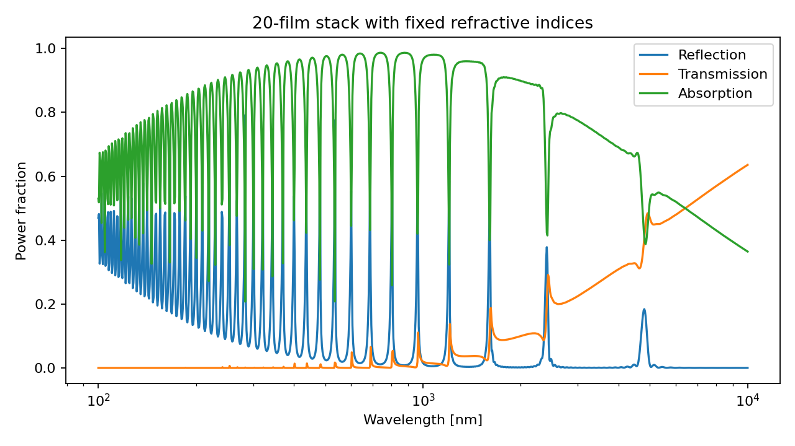

# Thin-film reflection and transmission

A Python adaptation of Shawn Divitt's
[jreftran calculator](https://www.mathworks.com/matlabcentral/fileexchange/50923-jreftran-a-layered-thin-film-transmission-and-reflection-coefficient-calculator).
It uses characteristic matrices to calculate reflection, transmission, and
absorption in a planar multilayer stack.

## Run

Use Python 3.10 or later. From the repository root:

```bash
python -m venv .venv
source .venv/bin/activate
python -m pip install -r requirements.txt
python j_reftran_broadband.py
```

In Windows PowerShell, activate with `.venv\Scripts\Activate.ps1`.

The script plots a wavelength sweep for 20 absorbing films, each 10 nm thick
and preceded by a 2.4 µm air gap. The refractive indices are held fixed over
100–10,000 nm. This illustrates interference in the stack; it is not a
broadband prediction for gold. A material calculation needs refractive-index
data at each wavelength.

To save the plot:

```bash
python j_reftran_broadband.py --output results/spectrum.png
```



## Calculate a single stack

```python
import numpy as np

from j_reftran_broadband import jreftran_rt

r, t, R, T, A = jreftran_rt(
    wavelength=500.0,
    d=[np.nan, 200.0, np.nan],
    n=[1.0, 0.9707 + 1.8562j, 1.0],
    t0=0.0,
    polarization=0,
)
print(f"R={R:.6f}, T={T:.6f}, A={A:.6f}")
# R=0.470248, T=0.000116, A=0.529636
```

This reproduces the original jreftran example: a 200 nm film between air
half-spaces, using the quoted optical index at 500 nm.

| Argument | Convention |
| --- | --- |
| `wavelength` | One vacuum wavelength, in nm |
| `d` | Layer thicknesses in nm, ordered from incident side to substrate |
| `n` | Complex refractive indices in the same order; positive imaginary part gives absorption |
| `t0` | Incidence angle in degrees, measured from the normal |
| `polarization` | `0` for TE/s; `1` for TM/p |

The first and last entries describe semi-infinite media. Their thicknesses
are ignored, so `np.nan` is used as a placeholder. The two arrays must have
equal lengths.

The function returns complex amplitude coefficients `r, t` and power fractions
`R, T, A`. The power normalization assumes lossless incident and exit media
with propagating waves. All layers are isotropic and nonmagnetic, and
interference is coherent through the stack. The function evaluates one
wavelength at a time; loop over wavelengths and supply dispersive indices
when needed.

## Checks

```bash
python -m unittest discover -s tests -v
```

The checks cover Fresnel reflection at a single interface, lossless-film
energy balance, equal s/p results at normal incidence, and the original
absorbing-film example.
